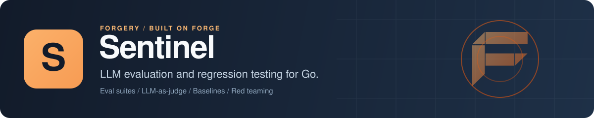

<p align="center">
  
</p>

# Sentinel: LLM evaluation and AI agent testing for Go

Sentinel is an open-source Go library for evaluating LLM applications and AI agents. You write suites of test cases, run them against a model, an agent or any Go function, and score each output with deterministic checks, LLM-as-judge scorers or persona-aware scorers for agents. Results are stored, so you can save a baseline and catch regressions when a prompt or a model changes, generate red-team cases for prompt injection and jailbreaks, and fail a `go test` run in CI when quality drops. It works standalone or as a [Forge](https://github.com/xraph/forge) extension.

[](https://go.dev/dl/) [](https://github.com/xraph/sentinel/actions/workflows/ci.yml) [](https://pkg.go.dev/github.com/xraph/sentinel) [](https://github.com/xraph/sentinel/stargazers)

[Documentation](https://www.xraph.com/docs/sentinel) · [Quick start](#quick-start) · [Features](#why-sentinel) · [Scorers](#scorers) · [Baselines](#baselines-and-regressions) · [CI](#evals-in-go-test) · [Forge](#use-it-with-forge) · [FAQ](#faq)

## Quick start

You need [Go 1.26 or later](https://go.dev/dl/). This example doesn't call a model, so you don't need an API key.

```bash
go get github.com/xraph/sentinel@latest
```

Save this as `main.go`:

```go
package main

import (
	"context"
	"fmt"
	"log"
	"strings"

	"github.com/xraph/sentinel/engine"
	"github.com/xraph/sentinel/scorer"
	"github.com/xraph/sentinel/store/memory"
	"github.com/xraph/sentinel/suite"
	"github.com/xraph/sentinel/target"
	"github.com/xraph/sentinel/testcase"
)

func main() {
	ctx := context.Background()

	eng, err := engine.New(engine.WithStore(memory.New()))
	if err != nil {
		log.Fatal(err)
	}

	s := &suite.Suite{Name: "capitals"}
	if err := eng.CreateSuite(ctx, s); err != nil {
		log.Fatal(err)
	}

	cases := []*testcase.Case{
		{SuiteID: s.ID, Name: "france", Input: "What is the capital of France?", Expected: "Paris"},
		{SuiteID: s.ID, Name: "japan", Input: "What is the capital of Japan?", Expected: "Tokyo"},
	}
	if err := eng.CreateCaseBatch(ctx, cases); err != nil {
		log.Fatal(err)
	}

	// The thing under test. Swap this for target.NewLLMTarget or your own agent.
	bot := target.FromFunc("lookup-bot", func(_ context.Context, input string) (string, error) {
		if strings.Contains(input, "France") {
			return "The capital of France is Paris.", nil
		}
		return "I'm not sure.", nil
	})

	res, err := eng.RunEval(ctx, &engine.RunConfig{
		SuiteID: s.ID,
		Target:  bot,
		Scorers: []scorer.Scorer{
			scorer.FromFunc("mentions_expected", func(_ context.Context, in *scorer.Input) (*scorer.Output, error) {
				ok := strings.Contains(in.Actual, in.Expected)
				score := 0.0
				if ok {
					score = 1
				}
				return &scorer.Output{Score: score, Passed: ok}, nil
			}),
			&scorer.LengthScorer{MaxTokens: 50},
		},
	})
	if err != nil {
		log.Fatal(err)
	}

	fmt.Printf("passed %d of %d (pass rate %.0f%%, average score %.2f)\n",
		res.Stats.Passed, res.Stats.TotalCases, res.Stats.PassRate*100, res.Stats.AvgScore)
	for _, r := range res.Results {
		fmt.Printf("  %-7s %-6s %.2f\n", r.CaseName, r.Status, r.Score)
	}
}
```

Run it:

```bash
go mod tidy
go run .
```

```text
passed 1 of 2 (pass rate 50%, average score 0.75)
  japan   fail   0.50
  france  pass   1.00
```

The bot only knows France, so the Japan case fails the first scorer and passes the length check, which averages to 0.50, under the default pass threshold of 0.7. Cases run concurrently, so your order may differ. Point `target` at a real model and the same suite tells you whether a prompt change helped or hurt.

## Why Sentinel?

Changing a prompt, a model or an agent's tools changes its answers in ways a unit test doesn't see. You need a fixed set of inputs, scores you can compare from one run to the next, and a record of what passed last week. Sentinel keeps all of that in your own database and runs inside your Go process, so the evals live next to the code they test.

| You need | Sentinel gives you |
| --- | --- |
| A repeatable set of test inputs | Suites and cases, created in Go, imported from JSON, CSV or JSONL, or generated by an LLM |
| Something to test | Targets for a raw LLM call, a [Cortex](https://github.com/xraph/cortex) agent, or any Go function |
| Scores you can trust | Exact match, contains, regex, length, latency, cost, JSON validity and JSON Schema checks, with no model involved |
| Judgement where rules fall short | LLM-as-judge, factual accuracy, hallucination and embedding similarity scorers |
| Agent-specific checks | Scorers for skill and tool use, behavior triggers, thinking phases, perception focus, trait consistency, communication style and persona coherence |
| To know when quality drops | Baselines per suite, compared after every run, with a hook that fires on a regression |
| Adversarial coverage | Red-team generators for prompt injection, jailbreaks, system prompt leakage, hallucination and off-topic requests |
| A gate in CI | `sentineltest` assertions for `go test`, and terminal, JSON, HTML and CI report formats |
| Prompt history | Prompt versions per suite, so a run records which prompt it used |

## Targets

A target is the thing you're testing. You can wrap anything that has `Name()` and `Call(ctx, input)`:

| Target | Constructor |
| --- | --- |
| Any Go function | `target.FromFunc(name, func(ctx, input string) (string, error))` |
| One LLM call | `target.NewLLMTarget(client, model, systemPrompt, temperature)` |
| An agent | `target.NewAgentTarget(client, agentID, personaRef)` |

`NewLLMTarget` takes a `target.LLMClient`, a one-method interface (`Complete(ctx, model, systemPrompt, userInput, temperature)`) that you implement over whichever SDK or gateway you use. An agent target returns the agent's execution trace alongside its output, which is what the persona scorers read.

## Scorers

Every scorer returns a score from 0 to 1 and a pass or fail. You can mix as many as you like in one run: the case's score is their average, and the case passes when that average reaches `PassThreshold` (0.7 by default). If a scorer errors, the case is marked as an error and never counts as a pass.

| Kind | Scorers |
| --- | --- |
| Deterministic | `ExactScorer`, `ContainsScorer`, `NotContainsScorer`, `NewRegexScorer(pattern)`, `LengthScorer`, `LatencyScorer`, `CostScorer`, `JSONValidScorer`, `JSONSchemaScorer` |
| Model-graded | `NewLLMJudgeScorer(client, model, criteria)`, `NewFactualScorer`, `NewHallucinationScorer`, `NewSemanticScorer(embeddings, threshold)` |
| Agent behavior | `NewSkillUsageScorer`, `NewBehaviorTriggerScorer`, `NewCognitivePhaseScorer`, `NewPerceptionFocusScorer` |
| Agent persona | `NewTraitConsistencyScorer`, `NewCommunicationStyleScorer`, `NewPersonaCoherenceScorer` |
| Your own | `scorer.FromFunc(name, fn)` |

The deterministic ones are plain structs, as in `&scorer.ContainsScorer{Substring: "refund", CaseInsensitive: true}`. The model-graded ones take a `scorer.LLMClient`, which has the same `Complete` shape as the target's but returns a string.

## Baselines and regressions

You don't have to ask for the comparison. When a run completes, the engine loads the suite's latest baseline and compares pass rate, average score, each dimension and each case, and anything that falls more than `RegressionThreshold` (0.05 by default) below the baseline counts as a regression and fires the `OnRegressionDetected` hook, which is where you'd hang an alert. If the suite has no baseline yet, there's nothing to compare, and you get neither a pass nor a fail.

You save a baseline from a run you're happy with, with `eng.SaveBaseline` or `POST /sentinel/v1/suites/:suiteId/baselines` with the run ID. To check a run yourself:

```go
b, err := eng.GetLatestBaseline(ctx, suiteID)
if err == nil {
	rr := baseline.DetectRegression(res.Stats, res.Results, b, 0.05)
	if rr.HasRegression {
		log.Printf("regressed against %s by %.2f", b.Name, rr.WorstDelta())
	}
}
```

## Evals in go test

Run a suite inside an ordinary test and let `sentineltest` fail it:

```go
func TestSupportBot(t *testing.T) {
	res, err := eng.RunEval(t.Context(), &engine.RunConfig{
		SuiteID: suiteID,
		Target:  bot,
		Scorers: []scorer.Scorer{&scorer.JSONValidScorer{}, &scorer.LatencyScorer{MaxMs: 2000}},
	})
	if err != nil {
		t.Fatal(err)
	}

	_ = report.NewTerminalReporter().Render(os.Stdout, report.NewReport(res.Run, res.Results, res.Stats))

	sentineltest.Assert(t, res.Stats,
		sentineltest.MinPassRate(0.9),
		sentineltest.MaxLatency(2000),
	)
}
```

`sentineltest` also has `MinAverageScore`, `MaxCost`, and per-dimension checks such as `SkillProficiency`, `TraitConsistency` and `PersonaCoherence`. Mind the name of `NoRegressions()`: it fails when any case failed, and it doesn't look at a baseline. Use `baseline.DetectRegression` for that.

## Red teaming

```go
cases, err := eng.GenerateRedTeam(ctx, suiteID,
	[]redteam.AttackType{redteam.AttackInjection, redteam.AttackJailbreak}, 5)
```

That stores up to five cases per attack type in the suite, and you score them like any other run. The types are `AttackInjection`, `AttackJailbreak`, `AttackLeakage`, `AttackHallucination` and `AttackOfftopic`. Injection and leakage cases need the suite to have a system prompt, since that's what they try to extract.

## Storage and tenancy

| Backend | Package |
| --- | --- |
| PostgreSQL | `store/postgres`, `postgres.New(db *grove.DB)` |
| SQLite | `store/sqlite`, `sqlite.New(db *grove.DB)` |
| MongoDB | `store/mongo`, `mongo.New(db *grove.DB)` |
| Memory | `store/memory`, `memory.New()` |

You call `Migrate` on a Grove-backed store before first use, unless the Forge extension is running it for you. If you serve more than one app or tenant, put them on the context with `sentinel.WithApp` and `sentinel.WithTenant`, and a suite you create under that context belongs to that app.

## Use it with Forge

The `extension` package registers Sentinel as a Forge extension. It reads `extensions.sentinel` (or `sentinel`), takes its store from a `*grove.DB` in the container (picking Postgres, SQLite or MongoDB from the driver), mounts the HTTP API under `/sentinel`, and provides `*engine.Engine`. Register your targets by name so the dashboard can start runs against them:

```go
import (
	"github.com/xraph/forge"
	sentinelext "github.com/xraph/sentinel/extension"
)

app := forge.NewApp(forge.AppConfig{
	Name:        "evals",
	HTTPAddress: ":8080",
	Extensions: []forge.Extension{
		sentinelext.New(
			sentinelext.WithTarget("support-bot", "The support assistant in staging", bot),
		),
	},
})
```

```yaml
extensions:
  sentinel:
    base_path: /sentinel
    default_model: smart
    temperature: 0
    pass_threshold: 0.7
    regression_threshold: 0.05
    concurrency: 4
    shutdown_timeout: 30s
    grove_database: ""        # a named grove.DB; empty uses the default one
    dashboard_app_id: ""      # required for the dashboard, see below
    disable_routes: false
    disable_migrate: false
```

The [Forge dashboard](https://github.com/xraph/forge-dashboard) reads and writes the app named by `dashboard_app_id` when the signed-in user carries no app claim. It has no default, and with neither set every dashboard request is refused, because an empty app ID would match every app. Other options: `WithStore`, `WithGroveDatabase`, `WithScorer`, `WithEngineOption`, `WithExtension`, `WithConfig`, `WithBasePath`, `WithDisableRoutes`, `WithDisableMigrate` and `WithRequireConfig`.

The REST API mounts under `/sentinel/v1`, but on Forge v1.12.9 only 11 of the 29 routes in `api/` register. Forge rejects a handler that returns a slice, a map or `any` ("unsupported handler signature"), and `api` throws the registration error away, so those routes answer 404 (or 405 when another method shares the path). These are the ones you can call:

| Method | Path under `/sentinel/v1` |
| --- | --- |
| `POST` | `/suites` |
| `GET`, `PUT` | `/suites/:suiteId` |
| `GET` | `/cases/:caseId` |
| `POST` | `/suites/:suiteId/baselines` |
| `GET` | `/baselines/:baselineId` |
| `POST` | `/suites/:suiteId/prompts` |
| `POST` | `/suites/:suiteId/runs` |
| `GET` | `/runs/:runId`, `/runs/:runId/stats`, `/runs/:runId/report` |

Everything else is missing: listing suites, cases, runs, results, baselines, prompt versions and scenarios, deleting a suite or a case, creating and importing cases, setting the current prompt, exporting a report, red-team and scenario generation, run-with-baseline and model comparison (so `POST /suites/:suiteId/compare` is a 404). The one run route that does register doesn't pass a target to the engine yet, so `POST /suites/:suiteId/runs` answers 400 with `sentinel: no target configured`. Start runs from Go or from the dashboard for now.

## Lifecycle hooks

Implement any of the 15 hook interfaces in `plugin` and register the value with `engine.WithExtension`. They cover run start, completion and failure, each case, `OnRegressionDetected`, `OnBaselineSaved`, red-team and persona runs, prompt versions, comparisons and shutdown. `audit_hook` sends them to an audit trail such as [Chronicle](https://github.com/xraph/chronicle), and `observability` turns them into unlabelled counters.

## Traces and metrics

In a Forge app you don't wire anything. Every run gets an `evaluate run` span with an `evaluate case` span per case, and a `call target` and a `score output` span under each case. A run you start from the dashboard is its own trace, linked to the request that started it. `RunEval` nests under whatever span you call it in. The extension hands the engine `app.Metrics()`, so `/_/metrics` shows run and case counts, target and scorer latency, target tokens, runs in flight and regressions as `forge_sentinel_*`.

Spans and labels carry IDs, counts and fixed kinds only. Prompts, outputs, judge reasons, error messages and the names you gave scorers never reach your trace backend or your metrics. Outside Forge, pass a go-utils `metrics.Metrics` to `engine.WithMetrics` for the metrics; spans go to whatever tracer provider you've installed. The [observability page](https://www.xraph.com/docs/sentinel/infrastructure/observability) lists every span, attribute, metric and label.

## Documentation

| Topic | Read |
| --- | --- |
| First suite | [Getting started](https://www.xraph.com/docs/sentinel/getting-started), [architecture](https://www.xraph.com/docs/sentinel/architecture), [end-to-end pipeline](https://www.xraph.com/docs/sentinel/guides/full-example) |
| Runs and regressions | [Eval runs and results](https://www.xraph.com/docs/sentinel/execution/runs), [baselines and regression detection](https://www.xraph.com/docs/sentinel/execution/checkpoints), [red teaming](https://www.xraph.com/docs/sentinel/execution/memory) |
| Agent evaluation | [The human model](https://www.xraph.com/docs/sentinel/human-model/overview), [skills](https://www.xraph.com/docs/sentinel/human-model/skills), [persona coherence](https://www.xraph.com/docs/sentinel/human-model/personas) |
| Storage | [PostgreSQL](https://www.xraph.com/docs/sentinel/infrastructure/postgres), [SQLite](https://www.xraph.com/docs/sentinel/infrastructure/sqlite), [MongoDB](https://www.xraph.com/docs/sentinel/infrastructure/mongo) |
| Forge, HTTP and plugins | [Forge extension](https://www.xraph.com/docs/sentinel/guides/forge-extension), [HTTP API](https://www.xraph.com/docs/sentinel/api-reference/http-api), [plugin system](https://www.xraph.com/docs/sentinel/infrastructure/plugins), [configuration](https://www.xraph.com/docs/sentinel/concepts/configuration), [observability](https://www.xraph.com/docs/sentinel/infrastructure/observability) |

The Go API is on [pkg.go.dev](https://pkg.go.dev/github.com/xraph/sentinel).

## FAQ

### How do I evaluate LLM output in Go?

Put your inputs and expected answers in a suite, wrap the code that produces answers in a target, and call `eng.RunEval` with the scorers you care about. Start with deterministic scorers, and add `NewLLMJudgeScorer` where a rule can't express what good looks like.

### How do I catch prompt regressions before they ship?

Save a baseline from a good run. Every later run of that suite is compared against it automatically, and in CI you can call `baseline.DetectRegression` yourself and fail the test when `HasRegression` is true.

### Can Sentinel test for prompt injection and jailbreaks?

Yes. `GenerateRedTeam` adds injection, jailbreak, leakage, hallucination and off-topic cases to a suite. Score them like any other cases.

### Does Sentinel need an LLM to run?

No. The deterministic scorers and function targets run without one, as in the quick start. You only need a model client for LLM targets and the model-graded scorers.

### Can I use Sentinel without Forge?

Yes. `engine`, the stores, targets and scorers are plain Go. Forge comes in only through `api` and `extension`.

## Contributing

Issues and focused pull requests are welcome. Open an [issue](https://github.com/xraph/sentinel/issues) first for anything large.

```bash
git clone https://github.com/xraph/sentinel.git
cd sentinel
GOWORK=off go build ./...
make test     # go test -v ./...
make lint     # golangci-lint v2
make fmt      # gofmt and goimports
```

The Postgres and MongoDB store tests sit behind the `integration` build tag and CI never runs them, so after a change under `store/` run `GOWORK=off go test -tags integration -count=1 -v ./store/...` with Docker up. Skip `make build`, `make run` and `make dev`, which point at a `cmd/sentinel` that doesn't exist. [AGENTS.md](AGENTS.md) has the lint rules that bite and the release steps. Commits follow [Conventional Commits](https://www.conventionalcommits.org/), often with a scope, as in `fix(contract): ...`.

## License

MIT. See [LICENSE](LICENSE).

Sentinel is part of the [forgery stack](https://github.com/xraph/forge#the-forgery-stack) built on [Forge](https://github.com/xraph/forge), by [Rex Raphael](https://github.com/juicycleff) and [contributors](https://github.com/xraph/sentinel/graphs/contributors).
